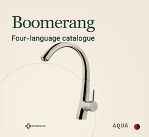
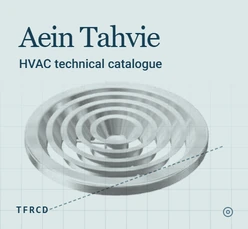
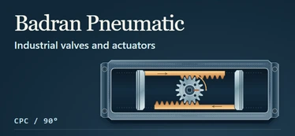
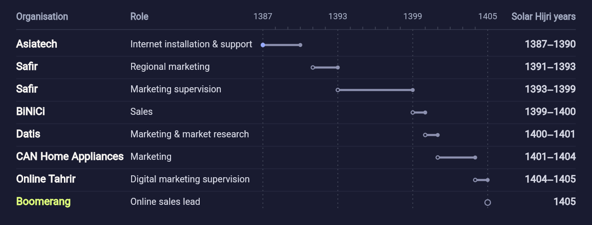

# Mohamad Reza Dalili

I’m a marketer. I started out installing and troubleshooting internet connections and now run online sales, using AI to help prepare product information. If buyers have to call to tell two models apart, I start by putting the photos and spec sheets side by side.

[My website](https://mrdalili.ir/?lang=en) · [CV](https://mrdalili.ir/profile.html?lang=en) · [Contact](https://mrdalili.ir/contact.html?lang=en) · [فارسی](https://github.com/mamadalili/mamadalili#readme)

## Selected projects

<a href="https://www.boomerang-co.com/en/products/aqua-kitchen/"><picture><source media="(max-width: 1140px)" srcset="https://raw.githubusercontent.com/mamadalili/mamadalili/main/assets/projects/boomerang-en-wide.webp"></picture></a>
<a href="https://github.com/mamadalili/tina-nail-atelier"><picture><source media="(max-width: 1140px)" srcset="https://raw.githubusercontent.com/mamadalili/mamadalili/main/assets/projects/tina-en-wide.webp"></picture></a>
<a href="https://mamadalili.github.io/aein-tahvie-industrial-trading-group/#/product/tfrcd"><picture><source media="(max-width: 1140px)" srcset="https://raw.githubusercontent.com/mamadalili/mamadalili/main/assets/projects/aein-en-wide.webp"></picture></a>
 
<a href="https://mrdalili.ir/?lang=en"><picture><source media="(max-width: 1140px)" srcset="https://raw.githubusercontent.com/mamadalili/mamadalili/main/assets/projects/personal-en-wide.webp"></picture></a>
<a href="https://onlinetahrir.com/"><picture><source media="(max-width: 1140px)" srcset="https://raw.githubusercontent.com/mamadalili/mamadalili/main/assets/projects/tahrir-en-wide.webp"></picture></a>
<a href="https://boomerangkala.com/"><picture><source media="(max-width: 1140px)" srcset="https://raw.githubusercontent.com/mamadalili/mamadalili/main/assets/projects/kala-en-wide.webp"></picture></a>
 
<a href="https://github.com/mamadalili/cpc-final-draft/blob/main/README.en.md"><picture><source media="(max-width: 1140px)" srcset="https://raw.githubusercontent.com/mamadalili/mamadalili/main/assets/projects/cpc-en-wide.webp"></picture></a>
<a href="https://github.com/mamadalili/boomerang-commerce-os/blob/main/README.en.md"><picture><source media="(max-width: 1140px)" srcset="https://raw.githubusercontent.com/mamadalili/mamadalili/main/assets/projects/commerce-os-en-wide.webp"></picture></a>

- **Boomerang.** A buyer can look up the Aqua kitchen tap and request a quote for the quantity they need. [Four-language catalogue source](https://github.com/mamadalili/boomerang-co)
- **Tina Nail Atelier.** Each specialist has a separate calendar. Guests pick a person and see that person’s available times. [Jalali calendar source](https://github.com/mamadalili/tina-nail-atelier/blob/main/src/features/booking/JalaliCalendar.tsx)
- **Aein Tahvie.** The model number on a round ceiling diffuser, TFRCD, takes the buyer straight to page 4 of the technical manual. [Product records and page references](https://github.com/mamadalili/aein-tahvie-industrial-trading-group/blob/main/data.js)
- **My personal site.** I write about my work and publish interactive articles. In one exercise, you can compare a repair shop’s weekly visits with the orders customers paid for. [Personal site source](https://github.com/mamadalili/personal-web)
- **Online Tahrir.** I launched online stationery sales and led the team responsible for content and sales support. [How the shop and marketplaces shared stock](https://mrdalili.ir/reading/en/turbin-marketplaces.html)
- **Boomerang Kala.** I launched online sales of vanities and taps for the Iranian market. Each product page needed to show buyers exactly what came in the set. [The story behind the shop](https://mrdalili.ir/reading/en/boomerang-online-sales.html)
- **Badran Pneumatic (CPC).** Buyers can browse industrial valves and actuators by what they need the equipment to do. To turn a valve shaft through 90 degrees, for example, open the [quarter-turn actuator template](https://github.com/mamadalili/cpc-final-draft/blob/main/type-category-quarter-turn-actuator.html).
- **Boomerang Commerce OS.** The product workspace keeps each version of a stock report. In the example, you can trace the 12 units back to the original file and the 9 units to the next one. [Both sample files](https://github.com/mamadalili/boomerang-commerce-os/tree/main/docs/examples)

## From internet support to online sales

<a href="https://mrdalili.ir/profile.html?lang=en&amp;tab=experience"><picture>
  <source media="(prefers-reduced-motion: reduce) and (max-width: 1023px)" srcset="https://raw.githubusercontent.com/mamadalili/mamadalili/main/assets/career/path-en-mobile-still.webp">
  <source media="(prefers-reduced-motion: reduce)" srcset="https://raw.githubusercontent.com/mamadalili/mamadalili/main/assets/career/path-en-still.webp">
  <source media="(max-width: 1023px)" srcset="https://raw.githubusercontent.com/mamadalili/mamadalili/main/assets/career/path-en-mobile.gif">
  
</picture></a>

Dates and a link to each role

| Solar Hijri year | Organisation | Role |
| --- | --- | --- |
| 1387–1390 | [Asiatech](https://mrdalili.ir/profile.html?lang=en&tab=experience&role=asiatech) | Internet Installation & Support Specialist |
| 1391–1393 | [Safir Language Academy](https://mrdalili.ir/profile.html?lang=en&tab=experience&role=safir-field) | Regional Marketing Specialist |
| 1393–1399 | [Safir Language Academy](https://mrdalili.ir/profile.html?lang=en&tab=experience&role=safir-lead) | Marketing Supervisor |
| 1399–1400 | [BiNiCi Trading](https://mrdalili.ir/profile.html?lang=en&tab=experience&role=binici) | Sales Specialist |
| 1400–1401 | [Pouyesh Rayan Datis](https://mrdalili.ir/profile.html?lang=en&tab=experience&role=datis) | Marketing & Market Research Specialist |
| 1401–1404 | [CAN](https://mrdalili.ir/profile.html?lang=en&tab=experience&role=can) | Marketing Specialist |
| 1404–1405 | [Online Tahrir](https://mrdalili.ir/profile.html?lang=en&tab=experience&role=turbin) | Digital Marketing Supervisor |
| 1405 | [Boomerang](https://mrdalili.ir/profile.html?lang=en&tab=experience&role=boomerang) | Online Sales Lead |

## Two models, one letter apart

A spec is missing. An AI assistant fills it in with a number from the next model over and writes a perfectly plausible description. In this exercise, you decide what to publish and what to send back to the product team. [Try the Boomerang exercise](https://mrdalili.ir/reading/en/boomerang-ai-operations.html#practice)

[More work stories](https://mrdalili.ir/work-stories.html?lang=en) · [LinkedIn](https://www.linkedin.com/in/mohamadreza-dalili/)
