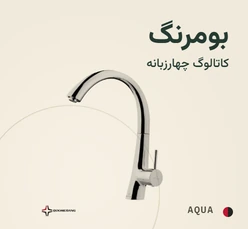
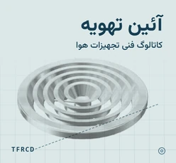
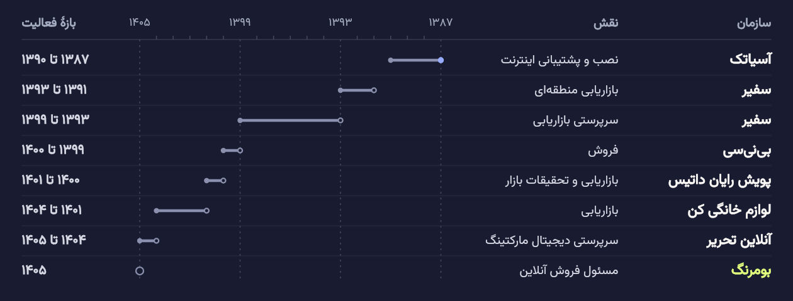

# محمدرضا دلیلی

از نصب و پشتیبانی اینترنت شروع کردم. امروز مارکتر و اپراتور هوش مصنوعی‌ام و روی فروش آنلاین کار می‌کنم. وقتی مشتری برای فهمیدن فرق دو مدل مجبور می‌شود زنگ بزند، اول عکس‌ها و مشخصات آن دو را کنار هم می‌گذارم.

[وب‌سایت من](https://mrdalili.ir/?lang=fa) · [رزومه](https://mrdalili.ir/profile.html?lang=fa) · [تماس](https://mrdalili.ir/contact.html?lang=fa) · [English](https://github.com/mamadalili/mamadalili/blob/main/README.en.md)

## چند نمونه از کارهایم

<a href="https://www.boomerang-co.com/fa/products/aqua-kitchen/"><picture><source media="(max-width: 1140px)" srcset="https://raw.githubusercontent.com/mamadalili/mamadalili/main/assets/projects/boomerang-fa-wide.webp"></picture></a>
<a href="https://github.com/mamadalili/tina-nail-atelier"><picture><source media="(max-width: 1140px)" srcset="https://raw.githubusercontent.com/mamadalili/mamadalili/main/assets/projects/tina-fa-wide.webp"></picture></a>
<a href="https://mamadalili.github.io/aein-tahvie-industrial-trading-group/#/product/tfrcd"><picture><source media="(max-width: 1140px)" srcset="https://raw.githubusercontent.com/mamadalili/mamadalili/main/assets/projects/aein-fa-wide.webp"></picture></a>

- در **بومرنگ**، خریدار شیر آکوا را در کاتالوگ پیدا می‌کند و برای تعداد موردنیازش قیمت می‌گیرد. [کد کاتالوگ چهارزبانه](https://github.com/mamadalili/boomerang-co)
- در **آتلیهٔ تینا**، هر متخصص تقویم خودش را دارد. مهمان اسم متخصص را انتخاب می‌کند و ساعت‌های آزاد همان نفر را می‌بیند. [کد تقویم شمسی](https://github.com/mamadalili/tina-nail-atelier/blob/main/src/features/booking/JalaliCalendar.tsx)
- در **آئین تهویه**، خریدار از روی کد دریچهٔ سقفی TFRCD مستقیم به صفحهٔ ۴ دفترچهٔ فنی می‌رسد. [داده‌های محصول و شمارهٔ صفحه](https://github.com/mamadalili/aein-tahvie-industrial-trading-group/blob/main/data.js)

## از پشتیبانی اینترنت تا فروش آنلاین

<a href="https://mrdalili.ir/profile.html?lang=fa&amp;tab=experience"><picture>
  <source media="(prefers-reduced-motion: reduce) and (max-width: 1023px)" srcset="https://raw.githubusercontent.com/mamadalili/mamadalili/main/assets/career/path-fa-mobile-still.webp">
  <source media="(prefers-reduced-motion: reduce)" srcset="https://raw.githubusercontent.com/mamadalili/mamadalili/main/assets/career/path-fa-still.webp">
  <source media="(max-width: 1023px)" srcset="https://raw.githubusercontent.com/mamadalili/mamadalili/main/assets/career/path-fa-mobile.gif">
  
</picture></a>

سال‌ها و شرح هر تجربه

| سال | سازمان | نقش |
| --- | --- | --- |
| ۱۳۸۷ تا ۱۳۹۰ | [آسیاتک](https://mrdalili.ir/profile.html?lang=fa&tab=experience&role=asiatech) | کارشناس نصب و پشتیبانی اینترنت |
| ۱۳۹۱ تا ۱۳۹۳ | [مؤسسه زبان سفیر](https://mrdalili.ir/profile.html?lang=fa&tab=experience&role=safir-field) | کارشناس بازاریابی منطقه‌ای |
| ۱۳۹۳ تا ۱۳۹۹ | [مؤسسه زبان سفیر](https://mrdalili.ir/profile.html?lang=fa&tab=experience&role=safir-lead) | سرپرست بازاریابی |
| ۱۳۹۹ تا ۱۴۰۰ | [بازرگانی بی‌نی‌سی](https://mrdalili.ir/profile.html?lang=fa&tab=experience&role=binici) | کارشناس فروش |
| ۱۴۰۰ تا ۱۴۰۱ | [پویش رایان داتیس](https://mrdalili.ir/profile.html?lang=fa&tab=experience&role=datis) | کارشناس بازاریابی و تحقیقات بازار |
| ۱۴۰۱ تا ۱۴۰۴ | [لوازم خانگی کن](https://mrdalili.ir/profile.html?lang=fa&tab=experience&role=can) | کارشناس بازاریابی |
| ۱۴۰۴ تا ۱۴۰۵ | [آنلاین تحریر](https://mrdalili.ir/profile.html?lang=fa&tab=experience&role=turbin) | سرپرست دیجیتال مارکتینگ |
| ۱۴۰۵ | [بومرنگ](https://mrdalili.ir/profile.html?lang=fa&tab=experience&role=boomerang) | مسئول فروش آنلاین |

## وقتی کد دو مدل فقط یک حرف فرق دارد

یک خانه در جدول مشخصات محصول خالی است. هوش مصنوعی ممکن است آن را با عددِ مدل کناری پر کند و جمله‌ای بنویسد که کاملاً طبیعی به نظر برسد. در این تمرین تصمیم می‌گیری کدام اطلاعات برای خریدار منتشر شود و کدام را باید از تیم محصول پرسید. [تمرین بومرنگ](https://mrdalili.ir/reading/fa/boomerang-ai-operations.html#practice)

[بقیهٔ روایت‌های کاری](https://mrdalili.ir/work-stories.html?lang=fa) · [لینکدین](https://www.linkedin.com/in/mohamadreza-dalili/)

